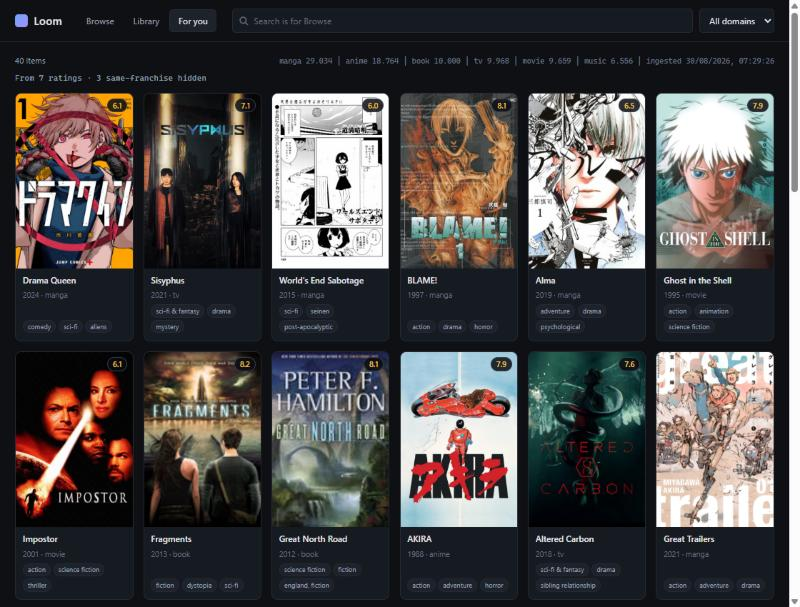

# Loom

[](https://github.com/JoaoCarlos134/Loom/actions/workflows/ci.yml)
[](LICENSE)

Cross-domain hybrid recommender system (anime / manga / books / music / movies / TV) that runs
as a local desktop app. No server, no cloud, no admin rights.

**Status: 1.0 release candidate** (version `1.0.0rc1`, unpublished). Six domains --
anime, manga, books, music, movies and TV -- from nine providers, reconciled across
sources (an anime and its own TMDB entry are one work), calibrated onto one popularity
scale per domain, and grouped into stories (an adaptation, its sequels, a book series
are one entry in results), browsable by tag, year, score and five sort orders. Two recommendation models -- text embeddings and item-item
collaborative filtering -- answer "more like this" in the detail view and "for you" from
your own ratings, across domains. **972 tests**, ruff- and mypy-clean, CI on Windows for
Python 3.12, 3.13 and 3.14.

The owner's full build, as last measured before this release's changes (by hand,
before `scripts/measure.py` existed): **~84,000 works** from ~105,000 stored rows (84%
with a real synopsis) and **19,172,125 anime ratings**; with goodbooks-10k's
5,976,479 book ratings (counted here on the same file) that is **25.1M**.
`scripts/measure.py` now prints these numbers from any build, read-only.



*Seven ratings (a novel, two manga, two films, two series) and one taste vector: For you answers across
five media at once, ranked in a shared text-embedding space. The real UI, over a full local build.*

## What's interesting here

- **A cross-domain bridge.** `/api/recommend` turns your ratings into one taste vector in a shared
  text-embedding space, so rating only anime can surface books. The 19.2M anime and 6.0M book ratings come
  from disjoint users, which is exactly why collaborative filtering alone could not.
- **One popularity scale across sources.** A raw audience count means something different in every
  source. A binned monotone curve, fitted on works two sources share, brings *Fullmetal Alchemist:
  Brotherhood*'s 5.1× spread across sources down to 1.48×. Percentile-within-source and a fitted power law
  were measured and rejected. See [Why these choices](#why-these-choices).
- **Entity resolution without merging.** Rows that are one work are linked by an exact shared id, and the
  representative is chosen by content, never by source name, so any source stays removable.
- **Claims are measured.** Similarity is scored against adaptation links the sources assert, with the
  pairs whose titles differ reported apart, because a shared title alone makes the headline number easy.
- **Built to run anywhere.** 972 tests that never touch the network, ruff and mypy clean, CI on Windows
  for Python 3.12-3.14, a setup that needs no admin rights, and a PyInstaller package for people
  without Python (built on Linux; its Windows build has not run yet).

## Quick start

```powershell
git clone https://github.com/JoaoCarlos134/Loom.git
cd Loom
uv sync
uv run python scripts/bootstrap.py --only book_goodbooks   # 10k books in seconds, no credentials
uv run python app.py
```

That is a browsable catalog with real data and nothing to sign up for. From there:

```powershell
uv run python scripts/bootstrap.py --starter   # the starter pack, once one is published
uv run python scripts/build.py                 # the full build: every source, resumable
```

No Python? The **packaged app** (`Loom` and `loom-data` in one folder) is built by
`.github/workflows/package.yml` and will run as is -- `loom-data --starter`, then
`Loom` -- once a build of it is published. It has been built and smoke-tested on
Linux only; the Windows build has not run yet. It cannot build embeddings: those
come prebuilt in the starter pack.

## Get the data

Each source's terms decide whether Loom may hand you its data or whether you fetch
it yourself. The **starter pack** holds only what may be shared; the **full build**
(`scripts/build.py`) fetches the rest on your machine, asking for a credential only
when a step needs one.

| Source | What it gives | In the starter pack? | Fetched by the full build | Needs |
|---|---|---|---|---|
| [goodbooks-10k](https://github.com/zygmuntz/goodbooks-10k) | 10k books, 6M ratings | **Shipped** (CC BY-SA 4.0); ratings used to train the shipped model, not included as rows | yes, ~2 min | nothing |
| [Open Library](https://openlibrary.org/) | book synopses, subjects, covers (linked) | **Shipped**: its data is public domain and contributions CC0, per its FAQ; some descriptions reproduce publisher copy | yes, ~1 h at 3 req/s | nothing |
| [Wikidata](https://www.wikidata.org/) | MyAnimeList <-> TMDB id pairs | not needed: no anime or TMDB rows ship | yes, one query | nothing |
| [AniList](https://anilist.co/) | anime and manga, synopses, tags, relations | **no**: its terms forbid hoarding and competing services | yes, ~50 min at 30 req/min | nothing |
| [MAL Kaggle dump](https://www.kaggle.com/datasets/azathoth42/myanimelist) | 2018 anime table, 19.2M ratings | **no**: scraped from MyAnimeList | yes, ~3 min after a ~2 GB download | a Kaggle API token, if Kaggle asks for one |
| [TMDB](https://www.themoviedb.org/) | films and TV | **no**: no redistribution, 6-month storage limit | yes, ~1 h | **your own free API read token** |
| [MusicBrainz](https://musicbrainz.org/) + [Deezer](https://www.deezer.com/) | composers credited by TMDB, their tags, pictures (linked) | **no**: the domain is TMDB's composers; tags are CC BY-NC-SA | yes, ~2.5 h at under 1 req/s | TMDB first |
| Embedding matrix | the content model's vectors | **Shipped** for the pack's works | yes: only works whose text changed | the model downloads once (~67 MB) |
| Collaborative model | "people who liked this also liked" | **Shipped**, trained on goodbooks ratings only | yes, ~2 min | nothing |

**Not published yet.** The starter pack's builder and installer and the packaged
app exist and are tested -- the pack only as a dry run on goodbooks-10k, without
vectors or Open Library text, and the app only on Linux. No GitHub Release exists
until the owner publishes one; `bootstrap.py --starter`
says so if you run it before then. Building the pack yourself from a full build:
`uv run python scripts/starter.py --version v1`, which writes to `DATA_DIR\dist`. A
vector ships only if its fingerprint matches the pack's own document for that work.
A matrix built before fingerprints has to be adopted (`scripts/embed.py --adopt`)
before anything re-ingests or relinks, then brought up to date with `scripts/embed.py`;
ROADMAP "Where we are" gives the order. (A dry run on goodbooks-10k alone, without
vectors or Open Library text, is a 7.8 MB archive.)

`--starter` never replaces a database holding your own ratings, verifies the archive
against `STARTER_SHA256` (or the published `.sha256`) and every file against the
pack's manifest, and moves anything it replaces (with `--force`) into a dated backup
folder in `DATA_DIR`.

The full build records each step as it finishes, so running it again carries on
where it stopped; `--status` shows what is done and roughly how long is left.

---

## Full setup on a Windows machine without admin rights

Every step below is user-space. Nothing installs a service, needs an installer, or
touches `Program Files`.

### 1. Install `uv`

In PowerShell:

```powershell
irm https://astral.sh/uv/install.ps1 | iex
```

This drops `uv.exe` in `%USERPROFILE%\.local\bin` and adds it to your user PATH.
Close and reopen the terminal, then check:

```powershell
uv --version
```

### 2. Clone and sync

```powershell
git clone https://github.com/JoaoCarlos134/Loom.git
cd Loom
uv sync
```

`uv sync` reads `uv.lock`, downloads a private CPython (3.12 by default; 3.13 and 3.14
work too; not 3.15, because pythonnet -- pywebview's Windows backend -- declares `<3.15`
and onnxruntime publishes no 3.15 wheel) into `%LOCALAPPDATA%\uv`, creates `.venv`, and
installs exact pinned versions. Every binary dependency is a prebuilt wheel — nothing
needs a compiler, so no MSVC build tools are required.

> If Windows Application Control blocks the Python inside uv's venv, make a stdlib
> venv (`py -3.12 -m venv C:\loomvenv`), then
> `uv export --frozen --all-groups --no-hashes -o req.txt` (not `> req.txt`: Windows
> PowerShell 5.1 redirects in UTF-16) and
> `uv pip install -r req.txt --python C:\loomvenv\Scripts\python.exe`, and run
> everything with that interpreter.

> On the secondary machine, if `uv sync` fails with `Acesso negado (os error 5)`
> or an `os error 396` on `.venv`, that's OneDrive locking files — run
> `$env:UV_LINK_MODE = "copy"` first. See [Where the data lives](#where-the-data-lives).

### 3. Configure

```powershell
copy .env.example .env
```

Defaults are fine. `REGION=BR` is carried for future region-aware providers.

### 4. Populate the catalog

```powershell
uv run python scripts/build.py            # everything, resumable; asks for TMDB once
uv run python scripts/build.py --status   # what is done, what is left, how long
```

The full build runs every source below in dependency order, then the derived tables
and both models, recording each step in `DATA_DIR\build-state.json`. Interrupted, it
carries on where it stopped. It starts from what an earlier `bootstrap.py` already did, asks
for a TMDB token the first time a TMDB step needs one and for a Kaggle API token
only if Kaggle refuses the download (both saved to `.env`), re-embeds only works
whose text changed, and keeps TMDB data under TMDB's six-month limit: it fetches
TMDB again once it is older, then deletes what the refetch did not renew.
`--no-input` never asks and skips what it cannot do.

`bootstrap.py` is the lower-level tool: it initialises the schema, runs the
ingesters named in `INGESTERS` (or `--only`), rebuilds the derived tables and prints
a summary. Idempotent — safe to re-run.

What each ingester brings. Counts are the owner's build, as works per domain (ROADMAP
"Done: all six domains, filtered"), except the book ratings, counted on the file here;
times are rough figures from earlier runs, the same ones `scripts/build.py` starts its
estimates from before it has timed a step on your machine:

| Ingester | Source | Owner's build | Cost |
|---|---|---|---|
| `anime_mal_csv` | Kaggle MAL dump, static | 14,478 anime in the file | ~2 GB download once, then ~2 min |
| `anime_anilist` | AniList GraphQL, live | with the dump: 18,764 anime works | ~20 min at 30 req/min, no key |
| `anime_jikan` | Jikan v4, live API | -- | degraded upstream; not in the full build |
| `anime_jikan_text` | Jikan v4, one title per request | -- | an alternative text source; not in the full build |
| `manga_anilist` | AniList GraphQL, live, partitioned by year | 29,034 manga | ~30 min |
| `movie_tmdb` | TMDB, live | 9,659 films | ~30 min; **needs a free API read token** |
| `tv_tmdb` | TMDB, live | 9,968 shows | ~25 min; same token |
| `book_goodbooks` | goodbooks-10k, GitHub CSVs | 10,000 books | seconds, no credential |
| `book_openlibrary` | Open Library | the synopses and covers goodbooks lacks | ~1 h at 3 req/s |
| `music_musicbrainz` | MusicBrainz + Deezer | 6,556 composers | ~2.5 h; MusicBrainz asks for 1 req/s and Loom stays under it |
| `music_commons` | Wikidata + Wikimedia Commons | 1,811 portraits | ~80 s, 33 requests; freely licensed |
| `music_deezer` | Deezer ids already stored | 4,501 pictures | under a second, no request; fallback where Commons has none |
| `anime_mal_ratings` | same Kaggle archive | 19,172,125 ratings | ~1.5 min; most of the database's size |
| `book_goodbooks_ratings` | goodbooks-10k, GitHub CSV | 5,976,479 ratings | ~1.5 min, 72 MB download, no credential |
| `idmap_wikidata` | Wikidata SPARQL (CC0) | MAL <-> TMDB id pairs | one query; links anime to their TMDB entries |

The two ratings loaders are not in the default `INGESTERS` list, because they are
most of a full build's size; the full build runs them, and `--only` runs them on
their own:

```powershell
uv run python scripts/bootstrap.py --only anime_mal_ratings
```

`anime_mal_csv` downloads `azathoth42/myanimelist` through kagglehub on first
run (cached in `~/.cache/kagglehub`, so later runs are offline); `anime_mal_ratings`
reads the user lists in the same archive. Point `MAL_CSV_PATH` / `MAL_RATINGS_PATH`
at local files to skip the download entirely.

> **Jikan is currently degraded** and serves only its warm cache: page 1 of
> `/top/anime` works, everything deeper 504s, so it contributes ~25 items and
> burns ~20 s exhausting retries each run. Drop it from `INGESTERS` if that is
> not worth it; the run is still recorded honestly as `status=error` and does
> not count as a successful ingest.

Useful flags:

```powershell
uv run python scripts/bootstrap.py --limit 100          # small run while developing
uv run python scripts/bootstrap.py --only anime_mal_ratings  # load the 19.2M ratings
uv run python scripts/bootstrap.py --only book_goodbooks_ratings  # 6M book ratings, no Kaggle
uv run python scripts/bootstrap.py --no-ingest          # schema + rebuild the derived tables
uv run python scripts/bootstrap.py --only anime_mal_csv # skip the live API
```

### 5. Run the app

```powershell
uv run python app.py
```

Opens a native window. Fallbacks:

```powershell
uv run python app.py --browser   # skip the webview, use the default browser
uv run python app.py --no-ui     # serve only, for curl/httpie against the API
```

### 6. Tests and checks

```powershell
uv run pytest          # 972 tests, none touching the network
uv run ruff check .    # lint
uv run mypy            # type check
```

Coverage is opt-in, so an everyday `pytest` stays fast: `uv run pytest --cov=recsys`.

No test touches the network or `%LOCALAPPDATA%` — the whole suite runs from
`tests/fixtures/`, so it needs no catalog and no credentials.

---

## Where the data lives

**Not in the repo.** `DATA_DIR` defaults to `%LOCALAPPDATA%\Loom`:

```
%LOCALAPPDATA%\Loom\
  recsys.db          SQLite catalog + ratings (+ -wal / -shm sidecars)
  cache\jikan\       HTTP response cache, sharded by URL hash
  logs\recsys.log    rotating log
```

This is deliberate. Loom is developed across two machines: a **primary** box
where the full catalog and the 19.2M ratings are built (unrestricted — Kaggle and
TMDB credentials, hours of ingest, gigabytes of DB), and a **secondary**,
locked-down corporate Windows machine (no admin, TLS interception, OneDrive-synced
home) used for code work. On that secondary machine the repo lives under a
OneDrive-synced folder, and sync clients take file locks on SQLite WAL sidecars
mid-write, which surfaces as random `database is locked` errors. `%LOCALAPPDATA%`
is never synced. Override with `DATA_DIR` in `.env` if you want the data beside
the code.

The same OneDrive locking hits `.venv`, so on the secondary machine run `uv`
with `UV_LINK_MODE=copy`, and pass `--no-sync` to `uv run` to skip the editable
rebuild each command otherwise triggers:

```powershell
$env:UV_LINK_MODE = "copy"
uv sync
uv run --no-sync pytest
```

Consequence worth knowing: the catalog does **not** travel between machines, except
as a starter pack. Each machine builds its own (`scripts/build.py`): the repo
reproduces the *catalog build*, and ships only the part of the catalog whose
licences allow it.

---

## Corporate TLS interception

On networks that terminate TLS at an inspecting proxy (the secondary machine's is
one), Python rejects the proxy's re-signed certificates because `ssl` uses certifi's
bundle rather than the Windows certificate store, where the corporate CA actually
lives. Symptom:

```
CERTIFICATE_VERIFY_FAILED: self-signed certificate in certificate chain
```

`src/recsys/net.py` calls `truststore.inject_into_ssl()` before the first handshake,
which points `ssl` at the OS trust store. Pure Python, no admin, and verification
stays **on** — we are not disabling certificate checks.

---

## Architecture

```
app.py                    pywebview window  ──┐
                                              │ http://127.0.0.1:<free port>
src/recsys/api/server.py  FastAPI  ───────────┘
              routes.py   /api/health /api/items /api/items/{uid} /api/series/{uid} /api/tags
                          /api/similar/{uid} /api/stats
                          /api/ratings/{uid} /api/library /api/recommend
              ui/         plain HTML + CSS + vanilla JS, served as static files

src/recsys/db.py          SQLite: items + items_fts (FTS5) + ratings + links
                                  + id_map + popularity_norm + works + relations
                                  + ingest_runs
           link.py        entity resolution: which rows are one work
           popularity.py  one popularity scale across a domain's sources
           relations.py   adaptation, franchise and book-series edges
           works.py       the read view: one row per work -- sort key, story
                          group, series card, Browse order, title keys
           derive.py      the four above, rebuilt in the one right order
           prune.py       drop rows the ingest filters would reject
           starter.py     build and install the starter pack
           build.py       the full build's steps, state and prompts

src/recsys/models/       reads the catalog, writes derived artifacts
              text.py    documents -> embedding matrix (parquet)
              similarity.py  brute-force nearest neighbours
              evaluate.py    recall against known adaptation links
              collaborative.py  item-item CF over every rating (parquet)
              profile.py     your ratings -> one taste vector
           schemas.py     UnifiedItem — the one row shape all domains collapse into
           config.py      pydantic-settings, the only reader of the environment

src/recsys/ingest/
  base.py                 Ingester ABC + the generic fetch→map→upsert run loop,
                          and IngestRunner, the Protocol bootstrap runs against
  registry.py             name → ingester. The single seam for new domains.
  ratelimit.py            sliding-window limiter (3/s AND 60/min) + jittered backoff
  cache.py                on-disk response cache keyed by URL
  kaggle.py               locate a file in a Kaggle dataset, download if absent
  anime_jikan.py          Jikan v4 → UnifiedItem
  anime_mal_csv.py        Kaggle MAL CSV dump → UnifiedItem
  anilist.py              shared AniList client + mapper, used by both domains
  tmdb.py                 shared TMDB client + mapper, used by movie and tv
  anime_anilist.py        AniList ANIME → UnifiedItem (the source with text)
  manga_anilist.py        AniList MANGA → UnifiedItem, via adaptation edges
  movie_tmdb.py           TMDB film → UnifiedItem
  tv_tmdb.py              TMDB television → UnifiedItem
  book_goodbooks.py       goodbooks-10k CSVs → UnifiedItem
  music_musicbrainz.py    composers the catalog credits → UnifiedItem
  book_openlibrary.py     Open Library work text → UnifiedItem
  music_commons.py        Wikimedia Commons portraits → UnifiedItem
  music_deezer.py         Deezer pictures, from stored ids → UnifiedItem
  ratings_mal_csv.py      Kaggle MAL user lists → ratings rows (a sibling
                          contract, not an Ingester — see below)
  ratings_goodbooks.py    goodbooks-10k ratings → ratings rows (same contract)
  idmap_wikidata.py       Wikidata MAL <-> TMDB pairs → id_map (same contract)

scripts/  bootstrap.py (incl. --starter)  build.py  embed.py  cf.py
          measure.py  starter.py
packaging/loom.spec       PyInstaller: the app folder for people without Python
```

Adding `anime_mal_csv` cost exactly what the abstraction promised: one new file
in `ingest/`, one line in `registry.py`, and settings in `config.py`. No edit to
`db.py`, `routes.py`, `bootstrap.py` or the UI — `bootstrap.py` picks it up
through the registry and sets `target_count` generically.

### Why these choices

**One table, not one table per domain.** A hybrid recommender's whole value is
scoring an anime and a novel on the same axes. Per-domain tables would push that join
into the model layer, where it becomes a permanent tax. `UnifiedItem` pays the
normalisation cost once, at ingest.

**`item_uid` is derived, never assigned.** It is always
`"{domain}:{source}:{source_id}"`, computed by a pydantic validator, so it cannot
drift from its parts. Two sources describing the same work stay separate rows —
deduplication is Phase 2's job and needs both rows to survive to do it.

**`mean_rating` is normalised at ingest; `popularity` is calibrated after it.**
Rating scales are known up front, so each ingester rescales its own to 0–10.
Popularity cannot work that way: a raw audience count means something different
in every source, and no ingester can know the others' scales. So it is stored
raw and reconciled afterwards.

The reconciliation is in `src/recsys/popularity.py`, run straight after linking
because it needs to know which rows are the same work. Where two sources both
carry a work, that pair of numbers is an anchor; the anchors define a mapping
from one source's scale onto the reference's, and the result is written to
`popularity_norm`. Reads order by that. Raw `popularity` is never modified — it
is the honest source datum, and this is a second opinion stored beside it.

It was a real problem, not a theoretical one. *Fullmetal Alchemist:
Brotherhood* is one work carried by all three sources:

| | raw | calibrated |
|---|---|---|
| `anilist` | 724,564 | 853,610 |
| `jikan` | 3,709,700 | 1,265,703 |
| `mal` | 1,199,091 | 1,199,091 |

A 5.1× spread on vintage and definition alone, down to 1.48×. Before this,
Jikan's *least* popular row outranked AniList's most popular and Jikan held the
top seven slots of every listing.

Two things this deliberately is **not**:

- **Not percentile-within-source.** The obvious fix, and wrong: it assumes every
  source samples the same population. Jikan's rows are the *top* 25 anime, so
  ranking them among themselves puts its weakest row — still a top-25 title —
  last in the catalog. It inverts the error rather than fixing it.
- **Not a formula.** A fitted power law was measurably the wrong shape: against
  12,821 anchors it overestimated the quiet end by 1.47× and underestimated the
  popular end by 0.74×. The mapping is a binned monotone curve instead, which
  assumes only that the relationship increases.

The reference source is whichever covers most of the domain, chosen from the
data — naming one would mean editing `popularity.py` to add a source. A domain's
first source is its own reference, so books arriving with nothing to calibrate
against simply work. With too few anchors to shape a curve it falls back to a
median scale factor, and with none at all to quantile mapping, which is the only
path that reintroduces the representative-sample assumption and therefore warns.

**Three sources describe the same anime, and the catalog shows it once.** This
used to be an open wart: `anime:jikan:5114` and `anime:mal:5114` are one work,
and both appeared in search. Adding AniList would have made it three.

The fix is *resolution*, not merging. `src/recsys/link.py` groups rows by an
exact shared `external_ids.mal_id` — every anime source populates it, so this is
an integer join with no thresholds and no fuzzy title matching — and writes a
`links` row per group naming which row represents the work. `query_items`,
`count_items` and `domain_stats` show only representatives; `get_item` still
reaches any row by uid, and `link.work_members()` returns a work's full set.

Nothing is merged and nothing is deleted, which matters more than it looks:

- **Phase 3 wants the union, not the winner.** AniList brings the synopsis and
  the ranked tags; the 2018 dump brings a member count from a different era.
  A merge would have to pick one of each and throw the rest away, permanently.
- **A source stays removable.** Drop an ingester, re-run the linker, and the
  catalog is exactly what the remaining sources say. After a merge there is no
  way back.
- **`item_uid` stays derived.** Merging would need a synthetic row belonging to
  no source, and every id in the system is derived from its parts on purpose.

**The representative is chosen by content, never by source name.** `_richness()`
prefers a row that has a synopsis, then more tags, then more ratings, with a
deterministic tiebreak so a rebuild never reshuffles the catalog. This is why
AniList rows win today — they carry text — but the rule never mentions AniList.
A source-preference list would put source names inside `link.py` and `db.py` and
make "add a source" mean "edit them", which is exactly the coupling the
project's one invariant forbids.

Resolution runs from `bootstrap.py` after ingest, never as a registry entry: it
has to see every source's rows, and a registry entry would let `INGESTERS`
ordering put it first. It is a full rebuild each time — tens of thousands of
rows, well under a second, and an incremental linker would have to reason about
rows whose ids changed underneath it. `--no-link` skips it.

**An anime and its own TMDB entry are one work, through an exact id map.** TMDB files
a lot of anime under television and film, so a full build held *Steins;Gate* twice,
and rating one recommended the other; the owner counted 625 TMDB shows bearing exactly
an anime's title. TMDB rows carry no MAL id, so `link.py` could not join them -- and
an equal title is not evidence. Wikidata states the pair exactly (MyAnimeList anime ID
P4086 beside TMDB TV ID P4983 or movie ID P4947, CC0), so `idmap_wikidata` loads those
claims into `id_map` and the linker lets a row with no id of its own join the work a
claim names. A mapped row never represents the work (otherwise *Steins;Gate* would
move to the TV domain because TMDB lists more keywords), a claim cannot create a work
alone, and a TMDB show the map assigns to several MAL entries (one show, several
seasons) is left alone and counted.

**One entry per story.** An adaptation, its sequels and a book's volumes are
different works -- `relations`, never `links` -- but a page of results showing the
manga and the anime, or eight volumes of one series, says one thing several times.
`works.py` gives each work a group, the connected component of its adaptation,
franchise and series edges in representative space, and results suppress the
groups of what you asked about or rated and keep the best-scored work of every
other group. Series edges come from Goodreads' own title suffix, "(Death Note,
#5)", or a "Name, Vol. 5" title, keyed by series and first author; listings fold
each series behind its most read single volume. A component larger than
`MAX_GROUP_SIZE` is treated as crossovers chaining franchises together and left
ungrouped -- that cap is provisional until the full build's sizes are measured.

**Search fuses two rankings, and an exact title comes first.** bm25 alone put the
*Steins;Gate* series below four specials: it rewards repetition, and a special's
synopsis says the title three times. A title-only bm25 does not escape it (FTS5
normalises by the whole row's length). So a work whose title or alternative title
*is* what was typed leads; the rest are ordered by reciprocal rank fusion (k=60,
Cormack et al. 2009) of how well the title fits -- every word in the title, fewest
other words -- and the calibrated popularity ranked within each domain. Fusion
needs no scale shared between the two, so no weight had to be invented.

**Browse opens on covers, every medium on page one.** Calibration puts one domain's
sources on one scale; it says nothing across domains, where a Deezer fan count and a
MAL member count measure different things. So the all-domains listing, which has no
true popularity order, shows works with an image first and lets the domains take
turns by their own rank. A rank, not a percentile -- which is the
percentile-within-source trap above in another form. One domain's listing keeps its
plain popularity order.

**The embedding matrix is rebuilt only where text changed.** A full build of it is
2.5 hours. Each vector records a fingerprint of the document and model it came
from, so `embed.py` re-embeds changed and new works, drops vanished ones, and
`--check` says what is stale without embedding anything. A matrix older than
fingerprints is kept and reported as unverified, never claimed fresh.

**Ratings got a sibling contract, not an `Ingester` subclass.** The `Ingester`
pipeline is fetch → `UnifiedItem` → `upsert_items`, and every part of it is
wrong for a rating: it is not a catalog row, it goes to a different table, and
there are 19.2M of them rather than 14.5k. Unifying them would have meant
parameterising the run loop over row type, upsert function and dedup strategy —
an abstraction over two implementations that share only their bookkeeping. So
`ratings_mal_csv.py` shares `IngestResult` and the `ingest_runs` row, duplicates
the ~20-line batching loop, and satisfies a Protocol (`IngestRunner`) instead of
a base class. `bootstrap.py` and `registry.py` cannot tell the two apart.

**Ratings carry no foreign key to `items`.** The two loaders can then run in
either order, and a rating for an anime missing from the catalog survives rather
than being silently dropped. In practice all 19.2M resolve — the join is exact,
because both sides derive their uid through the same `make_item_uid`.

**The `ratings` table has no secondary index.** Its only reader will be a bulk
export to parquet, which is a full scan; an index on `item_uid` would cost a
random-order build over 19.2M rows at load time and buy nothing yet. Append a
migration when a query actually needs one.

**`raw_json` is stored per item.** A mapping bug is then fixable offline: correct
`map_item`, re-run the mapper over the DB, never re-hit the API.

**FTS5 with an external-content table.** The index stores no duplicate copy of the
text; three triggers keep it in sync with `items`. User input is tokenised and quoted
before it reaches `MATCH`, so `AND` / `*` / `NEAR` typed into the search box are
treated as ordinary words rather than as query syntax.

**Migrations-lite over Alembic.** `PRAGMA user_version` plus an ordered list of SQL
scripts in `db.py`. A single-file local database does not justify a migration
framework. Never edit a shipped migration; append a new one.

**Sync SQLite, async HTTP.** Ingest is network-bound and benefits from `asyncio`;
queries are local-file-bound and finish in microseconds, where a connection per
request is simpler and safer than sharing one across FastAPI's threadpool.

**No frontend build step.** Plain HTML/CSS/JS served by FastAPI, no CDN, no npm.
A build step would mean Node, and Node is off the table. All DOM insertion goes
through `textContent` — catalog synopses are third-party text and never touch
`innerHTML`.

---

## Where each future phase plugs in

Phases 0-3's first half are done (see ROADMAP). What is left, and where it goes:

| Phase | Work | Touches |
|---|---|---|
| 3 | Hybrid: blend content and CF into one ranking | `recsys/models/` -- both halves exist |
| 3 | Import a MAL/AniList library | one new file in `ingest/` writing `local:` ratings |
| 4 | Implicit signals (views, dismissals) | a new `events` table via a new migration |
| 4 | Similarity graph view | `/api/similar` exists; needs a canvas renderer |
| 4 | Region-aware availability | `REGION` setting — already threaded through config |

The invariant: **adding a domain must not require editing `db.py`, `routes.py`,
`bootstrap.py`, or the UI.** If a future ingester forces a change in any of those,
the abstraction in `ingest/base.py` is wrong and should be fixed rather than
worked around.

---

## API

| Route | Notes |
|---|---|
| `GET /api/health` | liveness + item count; `app.py` polls this before opening the window |
| `GET /api/items?domain=&q=&tag=&year_min=&year_max=&min_rating=&sort=&limit=&offset=` | one card per work and per book series; `series_sizes` says how many volumes a card stands for. `q`: exact titles first, then title match fused with per-domain popularity. No `q`: covers first, domains interleaved (one `domain`: its popularity). `domain` and `tag` repeat: several domains widen, several tags narrow. `sort` is `popularity`, `rating` (vote-weighted), `newest`, `oldest` or `title`; a sorted search does not fold series |
| `GET /api/tags?domain=&q=&limit=` | the most-carried tags and their counts, for a picker |
| `GET /api/items/{item_uid}` | `item_uid` is a path param — it contains `:` |
| `GET /api/series/{item_uid}` | the volumes of the book series a work is in, in order; 404 if none |
| `GET /api/similar/{item_uid}?method=&domain=&k=` | k nearest works; `method=content` (text embeddings) or `cf` (ratings), optionally within chosen `domain`s. Suppresses the work's own story (adaptations, sequels, series) and keeps one work per story, unless `same_franchise=true`; reports `n_suppressed` and `n_collapsed` |
| `GET /api/stats` | per-domain counts, sources, last successful ingest |
| `PUT /api/ratings/{item_uid}` | rate a work 1-10. Idempotent — rating it again is a correction. Resolved onto the row representing the work, so rating it from two of its rows is one rating |
| `GET /api/ratings/{item_uid}` | your score for one work, or 404 |
| `DELETE /api/ratings/{item_uid}` | forget it. The only deletion outside `prune.py` |
| `GET /api/library?domain=&q=&sort=&limit=&offset=` | what you have rated, newest first; `sort` is `recent`, `rating` or `title` |
| `GET /api/recommend?domain=&k=&same_franchise=` | works nearest your taste, without more of the franchises you rated unless asked. 409 if you have rated nothing the matrix can place, 503 if the matrix is unbuilt |

Interactive docs at `/docs` while the server runs.

The rating routes are the only ones that write. Everything else reports what
sources said; these record what *you* say, which is the one thing no ingester
can supply. `/api/recommend` is `/api/similar` with the query replaced by a
profile — so asking for books having rated only anime is the cross-domain
bridge doing the job it was built for, and it is the thing collaborative
filtering structurally cannot do here, since its ratings never cross a
domain: 19.2M are anime and 6M are books, from disjoint sets of users.

---

## Data sources, attribution and terms

Loom ingests from these third-party sources and ships only what the starter pack
names -- goodbooks-10k and Open Library, under their licences. The
catalog is built on your machine, from your own credentials where any are
needed, and lives outside the repository. What is committed here is code, plus
a handful of API responses of two or three records each used as test fixtures.

Each source sets its own terms. They are summarised below and the rate limiter
is configured to match; `config.py` is the one place those numbers live.

| Source | Data terms | Rate Loom uses | Their limit |
|---|---|---|---|
| [TMDB](https://www.themoviedb.org/) | Attribution required, see notice below. Non-commercial; API data not to be stored beyond 6 months | 20 req/s | 20 req/s |
| [goodbooks-10k](https://github.com/zygmuntz/goodbooks-10k) | **CC BY-SA 4.0** — credit required, ShareAlike on adapted data | one-off CSV download | — |
| [MusicBrainz](https://musicbrainz.org/) | Core data **CC0** (public domain); supplementary data CC BY-NC-SA 3.0 | 1 req/s | 1 req/s |
| [AniList](https://anilist.co/) | Not for use in competing anime/manga list or tracker services | 30 req/min | 30 req/min (temporarily reduced from 90) |
| [Open Library](https://openlibrary.org/) | Open data; bulk harvesting discouraged in favour of their monthly dumps | 3 req/s | 3 req/s identified, 1 req/s anonymous |
| [Jikan](https://jikan.moe/) | Unofficial MyAnimeList API | 3 req/s, 60 req/min | 3 req/s, 60 req/min |
| [MAL Kaggle dump](https://www.kaggle.com/datasets/azathoth42/myanimelist) | Kaggle's page appears to list ODbL / DbCL; the data is scraped from MyAnimeList — see below | local file, no requests | — |
| [Wikidata](https://www.wikidata.org/) | **CC0** | one SPARQL query, contact User-Agent | 60 s of query time a minute |
| [Deezer](https://developers.deezer.com/) | Non-commercial use; images may not be stored, so they are only linked (Deezer's developer terms and FAQ, as read from search results) | 8 req/s | 50 per 5 s (as above) |
| Goodreads' image server (`images.gr-assets.com`) | goodbooks-10k's cover URLs, only linked | none at ingest | -- |
| [Open Library covers](https://openlibrary.org/dev/docs/api/covers) | Linked by cover id, never downloaded | none at ingest; the browser loads them | by ISBN: 100 per 5 min; by id: none |

### TMDB

> This product uses TMDB and the TMDB APIs but is not endorsed, certified, or
> otherwise approved by TMDB.

TMDB's terms are the most restrictive of these. The standard licence is
non-commercial, forbids storing API data for longer than six months, and names
operating a recommendation service among the uses that require a separate
written agreement. Loom is a local, single-user, non-revenue application and no
TMDB data leaves the machine it was fetched on — but if you intend to run it as
anything other than that, read
[their terms](https://www.themoviedb.org/api-terms-of-use) first. TMDB is also
the only source that always needs a credential (Kaggle may ask for an API token),
and the only one Loom will refuse to run without.

How Loom keeps to the two clauses the audit could not settle from code alone: the
notice above is shown in the app's own footer, as the terms require (TMDB's logo is
not, yet); and **the full build keeps TMDB data under six months old** --
`scripts/build.py` counts a TMDB step older than `TMDB_MAX_AGE_DAYS` (180) as not
done and fetches it again and then deletes the TMDB rows and cached responses the
refetch did not renew, and no TMDB row ever goes into the starter pack. That holds
when you run the full build; a catalog built once with `bootstrap.py` and never
rebuilt ages like any other file, and deleting it, or running `build.py` again, is
yours to do. The "recommendation-based services" clause names operated services;
Loom is a local, single-user app, and that reading is the owner's, not TMDB's.

### goodbooks-10k

Book ratings and tags come from
[goodbooks-10k](https://github.com/zygmuntz/goodbooks-10k) by Zygmunt Zając,
licensed **CC BY-SA 4.0**. The five-book sample under `tests/fixtures/goodbooks/`
is redistributed under the same licence. ShareAlike attaches to adapted versions
of that data, not to the code in this repository that reads it.

### The MyAnimeList Kaggle dump

`azathoth42/myanimelist` supplies the 2018 anime snapshot and the 19.2M-rating
matrix. Kaggle's dataset page appears to list "Database: Open Database, Contents:
Database Contents" (ODbL / DbCL) -- read here from search results, since the page
could not be opened from the build machine -- but the data was scraped from
MyAnimeList.net, and an uploader's licence cannot clear MAL's own terms. Loom downloads it
through `kagglehub` under your Kaggle account and never redistributes it; the
four rows and eleven ratings under `tests/fixtures/` are there so the parser has
something to parse. If you intend to publish anything derived from this dataset,
resolve its provenance yourself first — this project has not been able to.

### What Loom asks of these services

Every ingester filters at the source, so a row rejected by a threshold is a
request never made. Responses are cached on disk for 30 days by default, which
means a re-run costs the API nothing. MusicBrainz is polled at one request a
second with a User-Agent naming a contact, because
[they throttle clients that do not identify themselves](https://musicbrainz.org/doc/XML_Web_Service/Rate_Limiting).
None of the rate settings should be raised; several of them sit exactly at a
documented ceiling.

Two known tensions, stated plainly rather than buried:

- `book_openlibrary` makes roughly one hundred batch calls to resolve ISBNs and then
  **one request per book** — about ten thousand for a full run. Open Library asks
  bulk consumers to use their monthly dumps. Responses are cached, the full build
  makes them once, and a published starter pack would carry the result so that most
  people never make them at all; the dump (~3 GB of works) remains the honest fix
  and is deferred (ROADMAP).
- AniList's current terms (AniList/docs, `docs/guide/terms-of-use.md`, 2026-08-17)
  prohibit "hoarding or mass collection of data from the AniList API" and use
  "within competing, non-complementary services ... including anime and manga list
  or tracker services". A full build's partitioned sweep (29,034 manga alone on
  the owner's build) is mass collection by any reading. Nothing from AniList is
  redistributed, but whether to keep the sweep, narrow AniList to enriching the MAL
  ids already held, or ask AniList is the owner's decision (ROADMAP).

---

## License

Loom's code is released under the [MIT License](LICENSE). The licence covers the
code only: data fetched from the sources above stays under each source's own
terms, and the goodbooks-10k sample in `tests/fixtures/goodbooks/` is CC BY-SA 4.0.
A starter pack carries its own `ATTRIBUTION.md`: its goodbooks-derived rows,
vectors and neighbours are shared under CC BY-SA 4.0, with the changes made listed,
and its Open Library text under Open Library's terms (public domain / CC0 per its
FAQ; some descriptions reproduce publisher copy).
